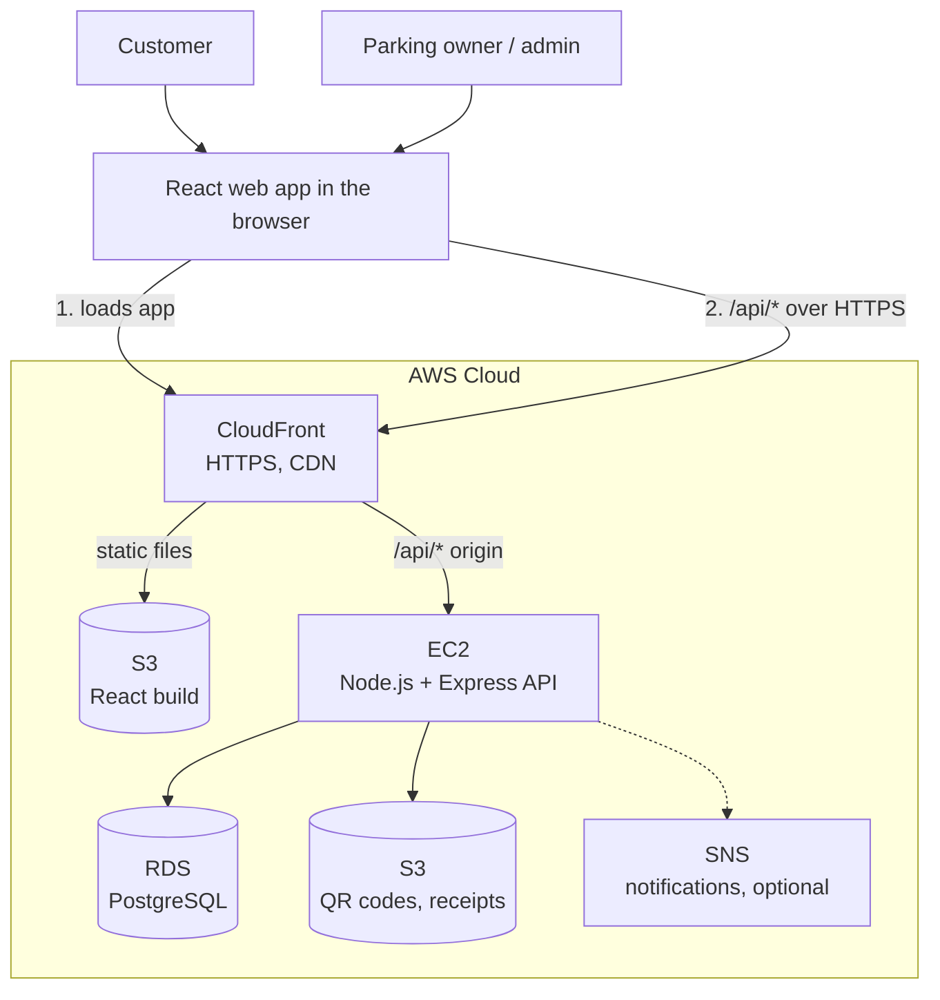

# Architecture

## Request flow

1. The browser loads the React build from CloudFront, which reads it from a private S3 bucket.
2. The app calls `/api/...` on the same CloudFront domain. CloudFront forwards `/api/*` to the EC2
   instance, so the browser only ever talks HTTPS to one origin.
3. The API reads and writes users, slots and bookings in RDS PostgreSQL.
4. When a booking is created, the API renders a QR code, stores it in the assets S3 bucket, and
   returns a short-lived pre-signed URL to it.
5. Optionally, the API publishes a booking message to an SNS topic (email/SMS subscribers).

## Why these services

| Need | Service | Reason |
|---|---|---|
| Serve the frontend globally over HTTPS | S3 + CloudFront | No server to manage; free HTTPS certificate |
| Run the API | EC2 | Full control, free tier, matches the course syllabus (IaaS) |
| Store relational data | RDS PostgreSQL | Managed backups and patching; data not tied to one machine |
| Store generated files | S3 | Durable object storage, access by pre-signed URL |
| Notifications | SNS | Managed pub/sub, optional |

## Local equivalents

| AWS | Local |
|---|---|
| CloudFront `/api/*` | Vite dev proxy (`frontend/vite.config.js`) |
| RDS | `docker compose up -d db` |
| S3 assets | `STORAGE_DRIVER=local`, files under `backend/uploads/` |
| SNS | log line in the API console |
