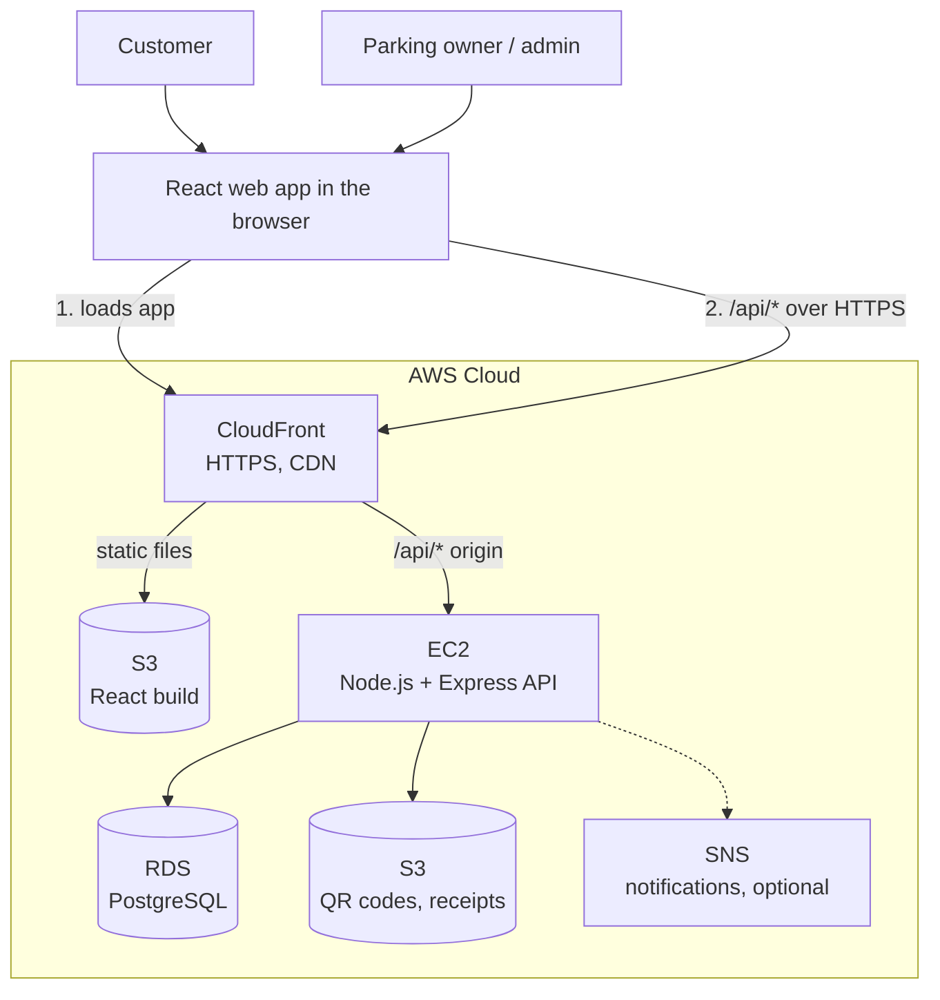

# Architecture

## Request flow

1. The browser loads the React build from CloudFront, which reads it from a private S3 bucket.
2. The app calls `/api/...` on the same CloudFront domain. CloudFront forwards `/api/*` to the EC2
   instance, so the browser only ever talks HTTPS to one origin.
3. The API reads and writes users, slots and bookings in RDS PostgreSQL.
4. When a booking is created, the API renders a QR code, stores it in the assets S3 bucket, and
   returns a short-lived pre-signed URL to it.
5. Optionally, the API publishes a booking message to an SNS topic (email/SMS subscribers).

## Why these services

| Need | Service | Reason |
|---|---|---|
| Serve the frontend globally over HTTPS | S3 + CloudFront | No server to manage; free HTTPS certificate |
| Run the API | EC2 | Full control, free tier, matches the course syllabus (IaaS) |
| Store relational data | RDS PostgreSQL | Managed backups and patching; data not tied to one machine |
| Store generated files | S3 | Durable object storage, access by pre-signed URL |
| Notifications | SNS | Managed pub/sub, optional |

## Local equivalents

| AWS | Local |
|---|---|
| CloudFront `/api/*` | Vite dev proxy (`frontend/vite.config.js`) |
| RDS | `docker compose up -d db` |
| S3 assets | `STORAGE_DRIVER=local`, files under `backend/uploads/` |
| SNS | log line in the API console |

---

# Cloud specification

Region `ap-south-1` (Mumbai), close to the users in Delhi. Phase 4 turns this section into scripts
and a console checklist in `infra/`; agents never create or delete AWS resources, a team member does.

## 1. Services and roles

| Layer | Service | Configuration |
|---|---|---|
| Edge | CloudFront distribution | Default behaviour → web bucket (cached). Behaviour `/api/*` → EC2 origin, all HTTP methods, query strings and headers forwarded (`AllViewerExceptHostHeader` origin request policy) with a custom cache policy `parkit-api` (TTL min 0, default 0, max 1 s, `Authorization` in the cache key). CloudFront forwards `Authorization` on GET only when it is in the cache key, which the managed `CachingDisabled` policy cannot do; the API also sends `Cache-Control: no-store`, so nothing is actually cached. The origin gets a secret custom header `X-Origin-Verify`. Viewers are redirected from HTTP to HTTPS. |
| Static hosting | S3 `parkit-web-<suffix>` | Private, Block Public Access on. Read only by CloudFront through Origin Access Control (OAC): the bucket policy allows `s3:GetObject` to the `cloudfront.amazonaws.com` service principal with an `AWS:SourceArn` condition naming this distribution. |
| Compute | EC2 `t3.micro` (or `t2.micro`, whichever the console marks free-tier eligible), Amazon Linux 2023 | Node.js 22 API under PM2 in the foreground (`pm2-runtime`, restarts on crash), started at boot by a systemd unit; Nginx on port 80 proxying to port 4000 and rejecting requests without the right `X-Origin-Verify` header. |
| Database | RDS PostgreSQL 16, `db.t4g.micro`, 20 GB gp3, single-AZ | Not publicly accessible. TLS required (`DATABASE_SSL=true`); the API verifies the server certificate with the AWS RDS CA bundle (`global-bundle.pem`) instead of accepting any certificate. |
| Files | S3 `parkit-assets-<suffix>` | Private, Block Public Access on. QR images under `qr/<32 hex chars>.png`. |
| Notifications (optional) | SNS topic `parkit-bookings` | Email subscription for the owner on each new booking. |
| Config and secrets | SSM Parameter Store | `/parkit/prod/DATABASE_URL`, `/parkit/prod/JWT_SECRET`, `/parkit/prod/ADMIN_PASSWORD` and `/parkit/prod/ORIGIN_VERIFY_SECRET` as SecureString. |
| Monitoring | CloudWatch | Built-in metrics, one dashboard and three alarms (section 7). |

**Single-page app routing.** A refresh on `/bookings` must return `index.html`. A small CloudFront
Function on the default behaviour rewrites paths without a file extension to `/index.html`.
Distribution-wide custom error pages are **not** used, because they would also replace the API's
JSON 403 and 404 responses with the HTML page.

## 2. Network and security groups

The default VPC is enough: EC2 in a public subnet, RDS in a DB subnet group, RDS not public.

| Security group | Inbound | Why |
|---|---|---|
| `parkit-api-sg` (EC2) | TCP 80 from the AWS-managed prefix list `com.amazonaws.global.cloudfront.origin-facing`; TCP 22 from the team member's IP only | Only CloudFront's servers can reach the API. The prefix list covers every CloudFront distribution, not just ours, so Nginx also requires the secret `X-Origin-Verify` header that only our distribution adds. |
| `parkit-db-sg` (RDS) | TCP 5432 from `parkit-api-sg` only | The database is reachable only from the API server. |

The browser talks only HTTPS, to CloudFront. CloudFront reaches EC2 over plain HTTP on port 80,
restricted by the prefix list and the secret header. The API connects to RDS over verified TLS.

**Known limitation.** The CloudFront → EC2 leg is not encrypted, so sign-in requests and tokens
cross it in clear. Fixing it needs a domain name and a certificate on EC2 (for example Let's
Encrypt on a free subdomain, with CloudFront set to "HTTPS only" towards the origin). It is out of
scope for the free-tier demo and is listed as future work.

## 3. Identity and access (IAM)

- EC2 runs with an instance role `parkit-api-role` whose policy allows only:
  `s3:PutObject` and `s3:GetObject` on `arn:aws:s3:::parkit-assets-<suffix>/*`;
  `sns:Publish` on the `parkit-bookings` topic;
  `ssm:GetParametersByPath` on both `arn:aws:ssm:ap-south-1:<account>:parameter/parkit/prod` and
  `.../parameter/parkit/prod/*` (IAM checks the path itself for this action). The default
  `aws/ssm` KMS key already allows decryption through SSM, so no `kms:Decrypt` statement is needed.
- No access keys exist on the server or in the repository; the AWS SDK picks up the role by itself.
- GitHub Actions deploys the frontend through a separate IAM role assumed with GitHub OIDC (no
  long-lived keys in repository secrets), allowed only to write the web bucket and create
  CloudFront invalidations.
- The root account is used once, to create an admin user with MFA; day-to-day work uses that user.

## 4. Secrets and configuration

- Production secrets (`DATABASE_URL`, `JWT_SECRET`) live in Parameter Store as SecureString.
- A systemd unit `parkit-api.service` runs `infra/start-api.sh` at boot. The script reads
  `/parkit/prod/*` with the AWS CLI into the process environment, exits with an error if
  `JWT_SECRET` or `DATABASE_URL` is missing, and then starts `pm2-runtime` in the foreground. PM2
  is never asked to `save` its process list, so secrets are not written to `~/.pm2/dump.pm2` or
  anywhere else on disk, and nothing secret is committed.
- `NODE_ENV=production` is set in the unit file. The API refuses to start without `JWT_SECRET`
  unless `NODE_ENV` is `development` or `test`, so a failed parameter load can never fall back to a
  development secret.
- The first admin account is created by `npm run seed` from `ADMIN_EMAIL` and `ADMIN_PASSWORD`. In
  production the seed refuses to run if `ADMIN_PASSWORD` is missing or is the development default.
- Non-secret settings (`STORAGE_DRIVER=s3`, `S3_ASSETS_BUCKET`, `AWS_REGION`, `CORS_ORIGINS`,
  `SNS_TOPIC_ARN`) are plain parameters under the same path.
- Locally, a git-ignored `.env` holds development values; `.env.example` lists every variable.

## 5. Data protection

- RDS automated backups with 7-day retention (point-in-time restore); a manual snapshot before the
  final demo.
- An S3 lifecycle rule deletes objects under `qr/` 90 days after creation, so storage does not grow
  forever. A QR image can always be regenerated from its booking code.
- S3 default encryption (SSE-S3) and RDS storage encryption are on.
- Passwords are stored only as bcrypt hashes; JWTs are signed with a long random secret.

## 6. Cost and budget

Created **before** any other resource: an AWS Budgets cost budget of USD 5/month, with email alerts
at USD 1 actual and USD 5 forecast.

| Service | Free-tier allowance (12-month free tier) | Expected use | Expected cost |
|---|---|---|---|
| EC2 `t3.micro` | 750 h/month | 1 instance, always on (about 730 h) | 0 |
| Public IPv4 on EC2 | 750 h/month | 1 address | 0 |
| EBS | 30 GB | 8 GB root volume | 0 |
| RDS `db.t4g.micro` | 750 h/month, 20 GB storage, 20 GB backups | 1 instance, 20 GB | 0 |
| S3 | 5 GB, 20,000 GET, 2,000 PUT | under 100 MB | 0 |
| CloudFront | 1 TB out, 10M requests/month (always free) | a few GB | 0 |
| SSM Parameter Store (standard) | free | about 7 parameters | 0 |
| SNS | 1,000 email deliveries/month | tens | 0 |
| CloudWatch | 10 alarms, 3 dashboards, basic metrics | 3 alarms, 1 dashboard | 0 |

AWS accounts created after 15 July 2025 get a credit-based free plan instead of these 12-month
allowances; the same setup then draws on the sign-up credits, and a free-plan account closes
after 6 months unless upgraded. Check which plan the account is on before Phase 4 and make sure the
end date is after the final demo. Either way, stop EC2 and RDS when not developing or demoing (a stopped RDS
instance restarts by itself after 7 days), and delete everything after grading.

## 7. Monitoring

A CloudWatch dashboard `parkit` with:
- EC2 `CPUUtilization` and `StatusCheckFailed`;
- RDS `DatabaseConnections`, `CPUUtilization` and `FreeStorageSpace`;
- CloudFront `Requests`, `4xxErrorRate` and `5xxErrorRate` (CloudFront metrics live in `us-east-1`).

Alarms, emailed through SNS: EC2 status check failed and RDS free storage below 2 GB (topic
`parkit-alerts` in `ap-south-1`); CloudFront 5xx rate above 5% for 5 minutes (a second
`parkit-alerts` topic in `us-east-1`, because an alarm can only notify a topic in its own region and
CloudFront metrics live there). Budget alerts (section 6) are emailed by AWS Budgets itself.

## 8. Deployment procedure

First deployment, in this order (Phase 4 turns each step into a checklist item or script):

1. Budget alert (section 6) and an admin IAM user with MFA.
2. Security groups `parkit-api-sg` and `parkit-db-sg` (section 2).
3. RDS instance in `parkit-db-sg`, backups on, not public. Note the endpoint.
4. S3 buckets `parkit-web-*` and `parkit-assets-*`, Block Public Access on, lifecycle rule on assets.
5. SSM parameters (section 4) and the IAM role `parkit-api-role` (section 3).
6. EC2 instance with that role and `parkit-api-sg`; run `infra/ec2-setup.sh` (Node.js, PM2,
   Nginx, the systemd unit); deploy the API; run `npm run migrate` and `npm run seed` against RDS
   (the seed takes the admin password from Parameter Store, never the development default).
7. CloudFront distribution with both origins, OAC (and its bucket policy), the SPA function, the
   `parkit-api` cache policy and the `X-Origin-Verify` origin header; add the CloudFront domain to
   `CORS_ORIGINS`.
8. Build the frontend, sync it to the web bucket, invalidate `/*`.
9. CloudWatch dashboard, the two `parkit-alerts` topics and the alarms; optional `parkit-bookings`
   topic and email subscription.
10. Smoke test through CloudFront: `GET /api/health` returns `"db":"up"`; sign in and call
    `GET /api/auth/me` with the token (proves the `Authorization` header reaches EC2); calling the
    EC2 address directly is refused.

**Releasing a new version.** API: `infra/deploy-api.sh` checks out the release tag into a new folder
on EC2, runs `npm ci` and `npm run migrate`, points the `current` symlink at it and runs
`systemctl restart parkit-api` (a few seconds of downtime, acceptable for this project). Frontend: build, `aws s3 sync --delete`, invalidate CloudFront. A GitHub Actions
workflow does the frontend part on every push to `main` once the tests pass.

**Rolling back.** API: point `current` back at the previous release folder and restart the unit.
Migrations only add things, so the older code still runs against the newer schema. Frontend:
redeploy the previous tag's build.

## 9. Live demo script

1. Open the CloudFront URL on a phone: HTTPS padlock, page served from the edge.
2. Register a customer, check availability, book "any free slot"; the QR code appears.
3. From EC2, `psql` against RDS: `SELECT * FROM bookings ORDER BY id DESC LIMIT 1;` shows the new row.
4. In the S3 console the QR object exists under `qr/`; its plain object URL returns AccessDenied
   (private bucket), while the app's pre-signed link works.
5. Two browsers book the same slot at the same moment: one succeeds, the other is told the slot
   was just taken (database constraint).
6. Sign in as admin: the booking is in today's list; scan or type its code to check in, then out.
7. Show the CloudWatch dashboard: request and CPU graphs moved during the demo.
8. How it would grow: a second EC2 instance behind an Application Load Balancer (the API is
   stateless), a Multi-AZ RDS standby, and a read replica for reports.
