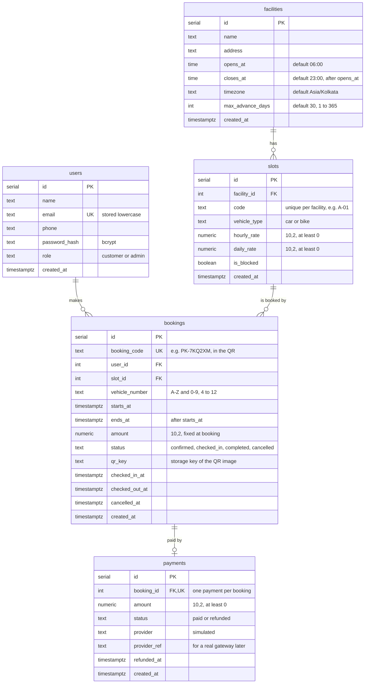

# ParkIt: ER diagram

The schema after migrations `001_initial_schema.sql` and `002_finalise_schema.sql`
(PostgreSQL 16, RDS on AWS).

**Integrity enforced by the database**
- **No double booking.** An exclusion constraint on `bookings` (`bookings_no_slot_overlap`: `slot_id` equal and
  `tstzrange(starts_at, ends_at)` overlapping, for `confirmed`/`checked_in` rows only) makes
  Postgres itself refuse an overlapping booking, even when two requests arrive at once. Ranges are
  half-open, so back-to-back bookings are fine, and cancelled bookings free the slot.
- **One vehicle, one place** (`bookings_no_vehicle_overlap`): the same rule on `vehicle_number`.
- `(facility_id, code)` is unique, emails are unique and lowercase, booking codes are unique,
  money columns cannot be negative, and a facility must close after it opens.
- Deleting a facility removes its slots; a slot or user with bookings cannot be deleted, and
  deleting a booking removes its payment.

**Booking states.** `confirmed → checked_in → completed`, and `confirmed → cancelled` (payment
`refunded`). `missed` is not stored: it is a `confirmed` booking whose `ends_at` has passed.

**Future scope.** Every slot already belongs to a facility, so several facilities can be added
later by giving `facilities` an owner, with no change to `bookings` or `payments`.
