# ParkIt: requirements

Source of truth for what ParkIt does. `docs/api.md` and the database schema follow this file;
change this file first. Decision numbers (D1..D20) match `docs/phases/phase-1.md`.

## 1. Proposal

**Problem.** At a private residential property in Delhi, parking capacity exceeds the number of
resident vehicles, so some spaces stay empty for long periods. Drivers nearby have no way to find
or reserve them, and the owner has no way to offer them, track who is parked, or earn from them.

**Solution.** ParkIt is a cloud-hosted web application for one privately managed parking
facility. Customers check availability for a date and duration, see the price, reserve a slot and
receive a QR booking code. The owner (admin) manages slots, rates and opening hours, checks
vehicles in and out by booking code, and sees occupancy and revenue. Payment is simulated. Booking
confirmation and cancellation emails go through Amazon SNS when a topic is configured (D21).

**Objectives**
1. Let a customer find, price and reserve a parking slot online in under a minute, from any device.
2. Make double booking impossible, even when two customers book the same slot at the same moment.
3. Give the owner one dashboard for slots, rates, arrivals and departures, occupancy and revenue.
4. Run the whole system on AWS managed services (CloudFront, S3, EC2, RDS), so it is available
   at any time, keeps its data safe without depending on a local machine, and stays within the
   free tier.
5. Keep the design ready for more facilities and owners later (every slot belongs to a facility).

**In scope:** one facility; customer and admin roles; car and bike slots; same-day bookings within
opening hours; simulated payment and refund; QR booking code; occupancy and revenue summary.

**Future scope:** several facilities and owners; overnight and multi-day bookings; a real payment
gateway (e.g. Razorpay); overstay charges; SMS/email notifications through SNS for every booking.

## 2. User stories

Each criterion names the endpoint (see `docs/api.md`) that satisfies it.

### Customer

**C1. Register and sign in.** As a driver, I want an account so my bookings are kept together.
- Registering with name, email and a password of 8+ characters creates a customer account and
  signs me in (`POST /api/auth/register`). The email is stored lowercase; a duplicate gets 409.
- Signing in with the right email and password returns a token (`POST /api/auth/login`); a wrong
  password gets 401 without saying which field was wrong.
- After signing in, the app loads my profile with the token (`GET /api/auth/me`).
- I can never register as an admin.

**C2. Check availability and price.** As a driver, I want to see which slots are free and what I
will pay before I book.
- For a vehicle type, start time and number of hours, I see every unblocked slot, whether it is
  free, and the price (`GET /api/slots/availability`); the facility's hours come from
  `GET /api/facility`.
- Requests outside the opening hours, before the current half hour, more than `max_advance_days`
  ahead or not on a `:00`/`:30` boundary get 400 with a message (D2, D6, D7).

**C3. Book a slot and get a QR code.** As a driver, I want to reserve a slot and get proof of it.
- Booking with a slot (or "any free slot", D18), start, hours and my vehicle number creates a
  `confirmed` booking with a simulated `paid` payment, a booking code and a QR image
  (`POST /api/bookings`). The QR image is loaded from `qr_url` (`GET /api/files/*` locally, a
  pre-signed S3 link on AWS).
- If the slot was taken in the meantime, my vehicle already has a booking at that time, or I
  already hold 3 active bookings (D20), I get 409 and nothing is charged.
- If the start is less than 2 hours away, I am told before confirming that I cannot cancel it.

**C4. See my bookings.** As a driver, I want my upcoming and past bookings in one place.
- `GET /api/bookings/mine?scope=active` lists `confirmed` bookings that have not ended and every
  `checked_in` booking (still parked); `scope=past` lists the rest, with `missed`, `completed` and
  `cancelled` shown as such.
- I can open one booking with its QR code (`GET /api/bookings/:code`); another customer's code
  gets 404, exactly like a code that does not exist.

**C5. Cancel.** As a driver, I want to cancel if my plans change.
- Until 2 hours before the start, cancelling sets the booking to `cancelled` and the simulated
  payment to `refunded` (`POST /api/bookings/:code/cancel`).
- Inside 2 hours, or for a booking that is not `confirmed`, I get 409 and nothing changes.

**C6. Show my QR at the gate.** As a driver, I want to show a code instead of explaining my booking.
- The QR encodes only the booking code; the admin scans or types it to find the booking (A6).

### Admin (parking owner)

**A1. Manage slots.** Create a slot with code, vehicle type and rates (`POST /api/admin/slots`), list
all slots including blocked ones (`GET /api/admin/slots`), and edit them
(`PATCH /api/admin/slots/:id`). A duplicate code gets 409.

**A2. Set rates.** Change a slot's hourly and daily rate (`PATCH /api/admin/slots/:id`). Existing
bookings keep the price they were booked at.

**A3. Set opening hours and booking window.** Change `opens_at`, `closes_at` and `max_advance_days`
(`PATCH /api/admin/facility`). Closing must be after opening; both are on `:00` or `:30`.

**A4. Block and unblock a slot.** Blocking (`PATCH /api/admin/slots/:id` with `is_blocked`) removes the
slot from availability; existing bookings stay until I cancel them. A slot that has ever been
booked cannot be deleted (`DELETE /api/admin/slots/:id` gets 409); I block it instead.

**A5. See bookings by day.** `GET /api/admin/bookings?date=` lists the bookings starting on an IST
date with customer name, vehicle, slot and state, including `missed` and overstaying ones. I can
cancel a `confirmed` booking that has not ended yet, with a full refund
(`POST /api/bookings/:code/cancel`).

**A6. Check in and check out.** By booking code (`POST /api/admin/bookings/:code/check-in` and
`/check-out`): check-in works from 15 minutes before the start until the end; check-out sets
`completed` and flags an overstay if it is after the end. Anything else gets 409.

**A7. See occupancy and revenue.** For a date range, `GET /api/admin/summary` shows revenue,
occupancy percentage, counts of completed, missed, cancelled, upcoming and checked-in bookings, and a
per-day breakdown.

## 3. Pricing rules

- Bookings last a whole number of hours, at least 1 (D2, D3). The request sends `hours`; the
  server computes `ends_at`. No rounding is needed (D4).
- `amount = min(hours × hourly_rate, daily_rate)`, using the rates of the booked slot (D5). The
  daily rate caps **one booking**; it is not a per-customer daily limit.
- The amount is fixed when the booking is created and stored on it; later rate changes never
  alter it (D16). Money is rupees with 2 decimals, sent as a string such as `"280.00"`.
- The availability response carries the amount for each slot, so there is no separate quote
  endpoint (D16).

| Slot rates | Hours | Calculation | Amount |
|---|---|---|---|
| Rs 40/h, Rs 300/day (car) | 7 | min(280, 300) | Rs 280.00 |
| Rs 40/h, Rs 300/day (car) | 8 | min(320, 300) | Rs 300.00 |
| Rs 40/h, Rs 300/day (car) | 17 | min(680, 300) | Rs 300.00 |
| Rs 15/h, Rs 100/day (bike) | 3 | min(45, 100) | Rs 45.00 |

## 4. Booking rules

| # | Rule |
|---|---|
| D1 | Times are stored as `TIMESTAMPTZ` (UTC in Postgres) and sent as ISO 8601 with an offset. Opening hours, dates and reports use the facility timezone, which is fixed to `Asia/Kolkata` in this version (the column exists for future facilities). |
| D2 | A booking starts on `:00` or `:30` IST and lasts whole hours. Opening and closing times are also on `:00`/`:30` (and never `24:00`), so the first and last valid starts are clear. |
| D6 | A booking fits inside one day's opening window: `opens_at ≤ start`, `end ≤ closes_at`, same IST date (default 06:00–23:00, so at most 17 h). |
| D7 | A booking may start no earlier than the start of the current half hour (at 10:10 a driver at the gate can still book 10:00; the whole hour is charged) and no more than `max_advance_days` (default 30, admin-editable) ahead. |
| D8 | A customer can cancel a `confirmed` booking until 2 hours before its start, with a full simulated refund. The admin can cancel a `confirmed` booking until its end (`now < ends_at`), also with a full refund. A missed booking (D11) can no longer be cancelled, so its payment and revenue never change afterwards. |
| D9 | Vehicle types are `car` and `bike`; a booking takes its slot's type. Vehicle numbers are stored uppercase without spaces or dashes and must match `^[A-Z0-9]{4,12}$` (e.g. `DL 3C AB 1234` → `DL3CAB1234`). |
| D10 | Only the admin checks in and out. Check-in: `confirmed`, while `starts_at − 15 min ≤ now < ends_at` (lost time is not refunded). Check-out: any `checked_in` booking; after the end it is flagged overstayed but not charged. **Known limitation:** the slot is reserved only until `ends_at`, so an overstaying car does not block the next booking; the admin list highlights overstays so the owner can move the car or reassign the next customer by hand. A `checked_in` booking stays in the customer's active list until check-out. |
| D11 | A `confirmed` booking with `ends_at ≤ now` (no check-in) is `missed`. This is derived when reading, never stored, so no background job is needed. It keeps its payment. |
| D12 | A blocked slot is hidden from availability; its existing bookings are not cancelled automatically. |
| D13 | A slot that has ever been booked cannot be deleted, only blocked. |
| D14 | Booking codes look like `PK-7KQ2XM`: `PK-` and 6 characters from `A–Z` and `2–9` without `I`, `O`, `0` and `1`, chosen with a cryptographic random generator. The database keeps them unique; on a clash the server draws again. A code alone never reveals customer data (D19). |
| D15 | Revenue = payments still `paid` for bookings starting in the range. Occupancy = booked slot-hours of non-cancelled bookings ÷ (all slots × current opening hours), capped at 100%. Counts (each booking in exactly one): `upcoming` = `confirmed` with `ends_at > now` (not started, or started but not yet arrived); `checked_in`, `completed`, `cancelled` as stored; `missed` per D11. |
| D17 | One vehicle cannot have two `confirmed`/`checked_in` bookings at overlapping times. |
| D18 | If the customer picks "any free slot", the server ranks the free unblocked slots of that type by the number of non-cancelled bookings whose `starts_at` is in the last 30 days (fewest first, tie: lowest code) and books the first. If another request takes that slot at the same moment, it tries the next one; only when none is left does it answer 409 "no free slot". This spreads use evenly across slots. |
| D19 | The QR encodes only the booking code. Booking details go only to the owner or an admin (anyone else gets 404, the same as an unknown code). QR files are stored under `qr/<32 hex chars>.png` (128 random bits); the file route serves only keys of exactly that form. |
| D20 | Fair use: a customer may hold at most 3 active (`confirmed`, not ended) bookings at a time (409 beyond that), and sign-in and registration are rate-limited per IP (10 per minute, 429). Payments are simulated, so this stops one account locking up every slot or someone else's number plate. |
| D21 | Booking emails (optional, Amazon SNS). With `SNS_TOPIC_ARN` set, registering subscribes the customer's email to the topic with a filter policy on their own address; AWS first sends them a subscription confirmation email. Once they confirm, they get an email when a booking is confirmed or cancelled: each message carries an `email` attribute, so SNS delivers it only to that customer. An owner email subscribed without a filter receives every message. Sending is best effort: it happens after the response is sent, and an SNS failure never fails a registration or booking. With no topic set, nothing is sent. |

**Booking states**

```mermaid
stateDiagram-v2
  [*] --> confirmed: book (simulated payment paid)
  confirmed --> checked_in: admin check-in (start − 15 min … end)
  confirmed --> cancelled: customer (≥ 2 h before start) or admin (before end); payment refunded
  confirmed --> missed: end passes without check-in (derived)
  checked_in --> completed: admin check-out (overstay flagged if after end)
  completed --> [*]
  cancelled --> [*]
  missed --> [*]
```

Only `confirmed` and `checked_in` bookings occupy a slot. Ranges are half-open `[start, end)`, so a
booking ending at 10:00 and another starting at 10:00 do not overlap.

**Double booking.** Two customers may check availability at the same moment and both see the slot
free. The database, not the application, settles it: an exclusion constraint on `bookings` refuses
any second `confirmed`/`checked_in` booking whose time range overlaps on the same slot, and the API
turns that error (`23P01`) into 409. A test inserts two overlapping bookings from two connections at
once and checks that exactly one succeeds.

## 5. Cloud requirements

Non-functional requirements and the AWS service that meets each one. Details are in
`docs/architecture.md`.

| Need | How it is met |
|---|---|
| Available from any device, over HTTPS | React build in S3, served worldwide by CloudFront with a free TLS certificate; `/api/*` goes through the same CloudFront domain to EC2, so the browser only ever uses HTTPS. |
| Data survives the loss of a server | Users, slots and bookings in RDS PostgreSQL with automated daily backups; QR files in S3; nothing kept on the EC2 disk, so the instance can be replaced. |
| Security | RDS and the assets bucket are private; RDS accepts connections only from the API's security group; EC2 accepts web traffic only from CloudFront carrying a secret origin header; the API reaches S3 through an EC2 instance role (no access keys); QR files are served by short-lived pre-signed URLs; secrets live in SSM Parameter Store; passwords hashed with bcrypt. |
| Scalability | The API is stateless (JWT, no server sessions, files in S3), so more EC2 instances could run behind a load balancer without code changes; static files never reach EC2. |
| Resource efficiency and cost | Free-tier instance sizes; CloudFront serves static files from the edge; an S3 lifecycle rule removes QR files of finished bookings; an AWS Budgets alert warns before any spend; D18 spreads use across slots. |
| Observability | CloudWatch metrics and alarms for EC2 CPU, RDS connections and storage, and CloudFront errors, shown during the demo. |
